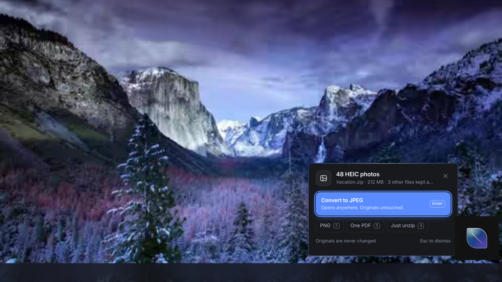
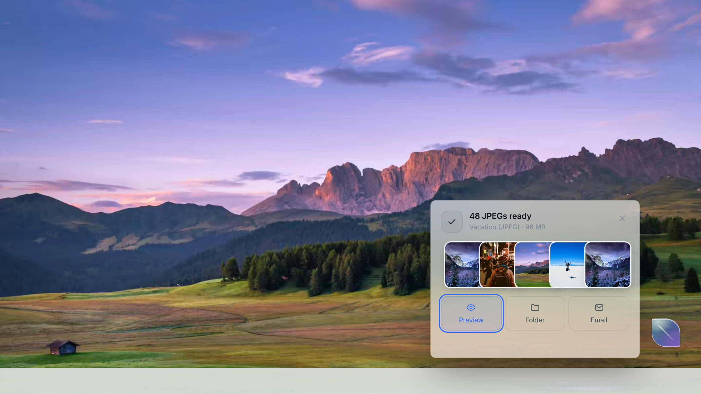
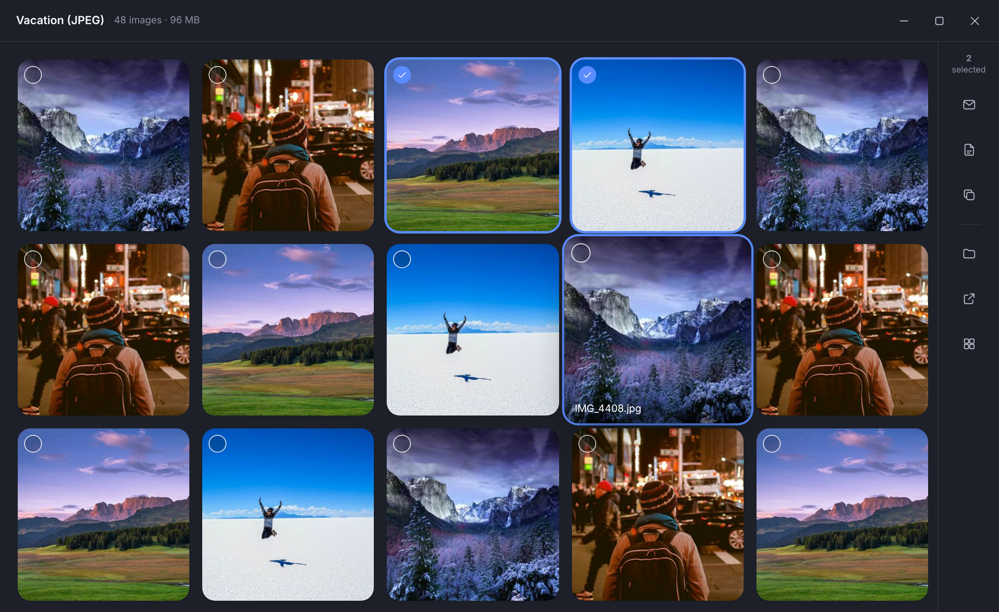
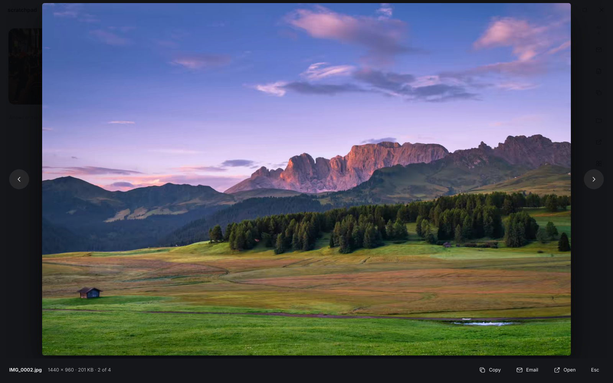

# Leaf

[](https://github.com/thezodiacavenger/leaf/actions/workflows/ci.yml)
[](https://github.com/thezodiacavenger/leaf/releases/latest)
[](LICENSE)


**Drop anything on the leaf. It works out what you want.**

Leaf is a small glass leaf that sits in the corner of the Windows desktop. Drag a zip, folder, email, PDF, Office file, photo or RAW file onto it. Leaf looks inside, suggests the one thing you most likely want, and does it with a single key press. Originals are never changed, and nothing leaves your PC.

| Suggest | Done | Gallery | Full screen |
|---|---|---|---|
|  |  |  |  |

## Install
Download the latest version from **[Releases](https://github.com/thezodiacavenger/leaf/releases/latest)**:
- **Leaf-Setup-x.y.z.exe**: installs Leaf with a Start-menu entry and uninstaller.
- **Leaf-x.y.z-portable.exe**: runs without installing.

Windows 10 or 11, 64-bit. Builds aren't code-signed yet, so on first run choose *More info → Run anyway*.

### Why Leaf?
- **Private by default.** Nothing is uploaded; conversions happen on your PC. Online converters can't promise that.
- **One drop, one decision.** Leaf reads the file and suggests the right action, instead of making you pick formats from menus.
- **Office-worker formats in one place.** Outlook emails and `winmail.dat`, PDF packages, CSV that keeps leading zeros, claim photo reports, RAW and HEIC photos.

---

## What it handles

★ = what Leaf suggests first. Everything else is one key away (2–5), or under **More** (M).

### Email & documents
| You drop | ★ Leaf suggests | Also |
|---|---|---|
| **Outlook email** (.msg) or .eml | **Save as PDF**: header, body, then each attachment as pages (PDF, photos and Office files converted) | Extract attachments |
| **Several emails** | **One PDF of all emails**: oldest first, attachments included, a bookmark per email | Save each as PDF · Extract attachments · Make a zip |
| **winmail.dat** | **Extract attachments** (the real files Outlook packed) | |
| **A mix** (PDFs, emails, Word/Excel/PowerPoint, photos) | **Combine into one PDF**: name order, fillable forms flattened, a bookmark per file. Built for submission packages | Make a zip |
| **A PDF** | Adapts to the file: locked → **Remove password**; scanned → **Make searchable**; fillable form → **Flatten**; otherwise → **Compress for email** (under 9 MB, text stays sharp) | Protect with password (AES-256) · Extract pages… · Split into pages · Rotate · Make editable (Word) · Remove hidden data |
| **Excel workbook** | **Save as PDF, fitted to page width** | Each sheet to CSV · Email as PDF · Remove hidden data |
| **CSV** | **Open safely as Excel**: leading zeros, long IDs and dates kept exactly as written | Clean up CSV |
| **Word / PowerPoint** | **Save as PDF** | Write as email (Outlook, formatting kept) · Email as PDF · Remove hidden data |
| **Multi-page TIFF / fax** | **Make PDF** at the correct page size | Make searchable PDF |

### Photos
| You drop | ★ Leaf suggests | Also |
|---|---|---|
| **RAW**: Canon CR2/CR3, Nikon NEF, Sony ARW, Fujifilm RAF, OM System/Olympus ORF, Panasonic Lumix RW2, DNG, Pentax PEF and more | **Convert to JPEG** at full resolution in the camera's colours, keeping camera, lens and date | PNG · Photo info · Make a zip · Photo report PDF |
| **HEIC** (iPhone), zipped or not | **Convert to JPEG** | PNG · Photo report PDF · One PDF · Photo info |
| **JPG / PNG / TIFF** | **Shrink for email** (2048 px, location removed) | Photo report PDF · Convert · One PDF · Photo info · Make searchable PDF · Remove hidden data |
| **Photos + a form** (e.g. a claim) | Photo actions first | Combine into one PDF |

- **Photo report PDF:** two photos per page, sorted by date taken, each captioned with file name, date, camera, lens and GPS. Built for claims, damage reports, RMAs and site visits.
- **Photo info:** camera, lens, exposure, date taken, shutter count, serial, location with a map link, and a searchable list of every tag. In full-screen preview, press **I**.

### Leaf Pile (optional)
On first run Leaf offers to add a **Leaf Pile** folder to your desktop, with an aurora folder icon. Anything you save or drop into it (an Outlook attachment, scanner output, a download) brings up Leaf's suggestion once the file has finished writing. Turn it on or off from the tray menu; Leaf never deletes what's in it.

---

## Design principles
1. **One obvious answer.** Leaf never asks a question it can answer itself. It reads a zip's contents or a PDF's structure first, then suggests one action.
2. **Low stimulation.** No sounds, no mascot chatter. Motion appears only to mean something: the leaf swells on drag, shows a progress ring, and nudges once when work finishes in the background.
3. **Keyboard first.** Enter, 2–5, M for More, Esc. In the gallery, use the arrows, Space, I, X and Ctrl+C.
4. **Safe by construction.** New files go next to the original or into a new folder. Nothing is overwritten. Emails render with scripts and network blocked, so tracking pixels never fire.
5. **Local only.** No cloud services. Office conversions use your own Word, Excel and PowerPoint. Text recognition uses Windows' built-in, offline engine.

---

## Compatibility
| | Windows 10 (64-bit) | Windows 11 21H2 | Windows 11 22H2+ |
|---|---|---|---|
| Runs | ✅ | ✅ | ✅ |
| Glass | Drawn glass | Drawn glass | Real acrylic (untick in tray if it misbehaves) |
| Text recognition | ✅ (1809+, needs an OCR language) | ✅ | ✅ |
| Office features | Classic Office (Word/Excel/PowerPoint) | same | same |
| "Write as email" / Outlook | Classic Outlook only; the new Outlook has no automation API, so Leaf falls back to showing the files | same | same |

Leaf runs on Electron 44 (security-supported, officially Windows 10 and up). On locked-down PCs where PowerShell is restricted (Constrained Language Mode), the Office and text-recognition features report a clear error. Everything else still works.

---

## Engineering

| Concern | Choice | Why |
|---|---|---|
| Runtime | Electron 44 | Supported release; Windows 10/11 |
| HEIC | `heic-decode` (libheif WebAssembly) in a worker-thread pool | Fast, no native code |
| RAW | Camera's embedded JPEG when full size, else LibRaw (`libraw-wasm`) in a hidden cross-origin-isolated "darkroom" window, tone-matched to the camera JPEG | Full resolution, camera colours, every brand |
| Metadata | ExifTool (bundled `exiftool.exe`) via `exiftool-vendored` | Reads and writes every brand; keeps date/camera/lens on converted files |
| Email | `@kenjiuno/msgreader` (+ RTF decompression), `postal-mime` (.eml), own TNEF parser (winmail.dat) | Pure JavaScript, no Outlook needed |
| Email → PDF | Hidden window: no JavaScript, no network, Chromium `printToPDF` | Exact rendering, no tracking |
| PDF | `@cantoo/pdf-lib` (pdf-lib fork with AES-256 encryption) | Combine, bookmarks, flatten, split, rotate, encrypt/decrypt, image recompression |
| Scanned PDF → images | `pdf.js` in a hidden window | Only for text recognition |
| Text recognition | Windows.Media.Ocr via PowerShell/WinRT; invisible text layer over the original page | Offline, free, no extra download |
| Office | PowerShell + COM, one session per batch | Exact layout; never closes a PowerPoint you had open |
| CSV → XLSX | Own minimal XLSX writer | Zero dependencies; columns typed safely |
| Zip | `yauzl` / `yazl` | Streams; blocks zip-slip paths |

```
src/
  main.js              windows, state, IPC, tray, Leaf Pile, protocol
  engine/
    sources.js         drop → items; file kinds; PDF/TIFF facts
    plan.js            the "brain": ranks suggestions
    run.js             photo conversions, zip/unzip, dispatch
    docs.js            email, combine, PDF toolkit, Office, CSV, report, OCR, fax
    mail.js render.js  email parsing + locked-down HTML→PDF
    pdf.js report.js   PDF toolkit; photo report & TIFF
    ocr.js office.js   Windows OCR; Office via COM
    raw.js darkroom.js sheet.js pool.js heic-worker.js
  ui/                  leaf, panel, gallery, darkroom, workroom
```

### Build
```bash
npm install
npm test           # engine tests (Linux: xvfb-run -a npm test)
npm run prebuild   # only when building on Linux/macOS: fetches the Windows ExifTool
npm run dist       # → dist/Leaf-<version>-portable.exe
```
Releases are built automatically on Windows by GitHub Actions when a `v*` tag is pushed.

### Size
The download is about 99 MB, most of it the Electron runtime. Leaf's own code and libraries are about 12 MB, plus 35 MB for ExifTool. Unused Chromium translations, the WebGPU shader compiler, duplicate library builds and the Linux copy of ExifTool are stripped at build time.

### Tested vs. not yet tested
- ✅ Tested end to end here (Linux, same Electron): HEIC, RAW (8 brands), Photo info, gallery and full screen, email → PDF (HTML/RTF/plain), multi-email PDF, winmail.dat (13 real samples), combine with bookmarks and flattening, compress (16.9 → 1.8 MB), password protect/unlock, extract/split/rotate, CSV → Excel, clean CSV, photo report, fax TIFF → PDF, the searchable-PDF pipeline (rendering + text layer), Leaf Pile, and the packaged build.
- ✅ Word → PDF confirmed on Windows by the user.
- ⚠️ Written against documented Windows APIs but **not yet run on Windows**: Excel/PowerPoint → PDF, Excel → CSV, PDF → Word, Remove hidden data (Office), Windows text recognition itself, the Leaf Pile folder icon, Send To, Start with Windows, acrylic glass.
- ⚠️ The `.exe` is unsigned, so SmartScreen warns on first run (More info → Run anyway). Sign it before a company-wide rollout.

### Roadmap
- **Next:** true redaction: select what to remove, and it is removed from the file, not just covered.
- Excel/PowerPoint "fit" options, PDF tables → Excel, naming rules.
- Connectors: OneDrive/SharePoint, Teams.
- Learns your habits: your usual choice becomes the default.
- Business drops: inventory export → aged-stock summary.

---

## Contributing
Ideas, bug reports and pull requests are welcome. Start with **[CONTRIBUTING.md](CONTRIBUTING.md)**: setup takes three commands, and adding a new file type usually touches two files. Please report security issues privately (see [SECURITY.md](SECURITY.md)).

## License
[MIT](LICENSE) © 2026 Emmet Adriaans. Bundled third-party components keep their own licences; see [THIRD_PARTY_NOTICES.md](THIRD_PARTY_NOTICES.md).
